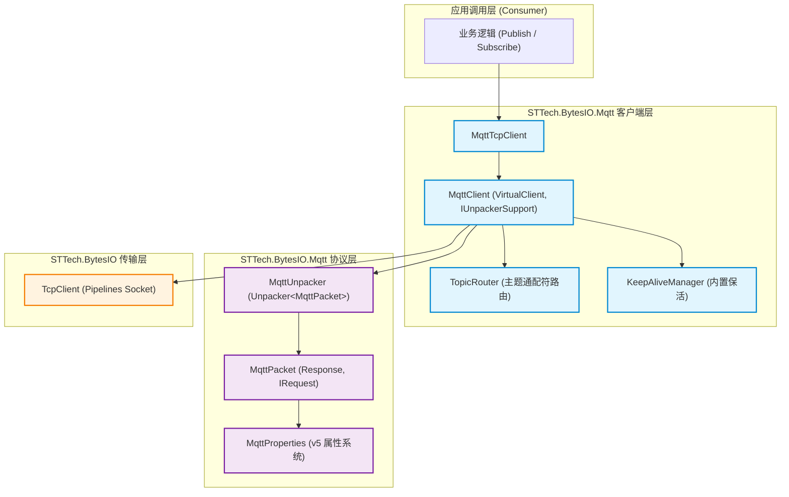

# STTech.BytesIO.Mqtt 类库 API 技术手册

本手册基于 Microsoft 技术文档准则与规范编写，详细介绍 **STTech.BytesIO.Mqtt** 类库的整体架构、核心 API 接口、枚举定义、报文体系及典型应用开发实践。

- **命名空间**：`STTech.BytesIO.Mqtt`
- **程序集**：`STTech.BytesIO.Mqtt.dll`
- **支持框架**：`.NET Standard 2.0` / `.NET Standard 2.1` / `.NET 6.0` / `.NET 8.0` / `.NET 9.0` / `.NET 10.0`
- **核心依赖**：`STTech.BytesIO` (核心通信库)

---

## 目录

1. [架构概述与设计理念](#1-架构概述与设计理念)
2. [枚举参考规范](#2-枚举参考规范)
   - [MqttProtocolVersion](#mqttprotocolversion)
   - [MqttPacketType](#mqttpackettype)
   - [MqttQualityOfServiceLevel](#mqttqualityofservicelevel)
   - [原因码枚举 (Reason Codes)](#原因码枚举-reason-codes)
   - [MqttPropertyId](#mqttpropertyid)
   - [MqttPayloadFormatIndicator](#mqttpayloadformatindicator)
3. [核心客户端 API 参考](#3-核心客户端-api-参考)
   - [MqttClient (虚拟客户端基类)](#mqttclient-虚拟客户端基类)
   - [MqttClient&lt;TClient&gt; (泛型客户端)](#mqttclienttclient-泛型客户端)
   - [MqttTcpClient (TCP 客户端)](#mqtttcpclient-tcp-客户端)
4. [报文与属性体系参考](#4-报文与属性体系参考)
   - [MqttPacket (报文抽象基类)](#mqttpacket-报文抽象基类)
   - [MQTT v5 属性系统 (MqttProperties)](#mqtt-v5-属性系统-mqttproperties)
   - [业务消息实体 (MqttApplicationMessage)](#业务消息实体-mqttapplicationmessage)
   - [配置选项与操作结果实体](#配置选项与操作结果实体)
5. [路由与解包组件](#5-路由与解包组件)
   - [MqttUnpacker (协议解包器)](#mqttunpacker-协议解包器)
   - [TopicRouter (主题通配符路由)](#topicrouter-主题通配符路由)
6. [开发指南与典型最佳实践](#6-开发指南与典型最佳实践)

---

## 1. 架构概述与设计理念

`STTech.BytesIO.Mqtt` 延续并参考了成熟工业类库 `STTech.BytesIO.Modbus` 的解耦设计哲学：
- **通信与协议彻底解耦**：客户端基于 `VirtualClient<TClient>` 虚拟客户端组合模式，将底层传输层（TCP、SSL/TLS 或自定义传输通道）与上层 MQTT 协议的编解码完全分离。
- **解包驱动**：内置基于 `ReadOnlySequence<byte>` 的高性能解包器 `MqttUnpacker`，无缝挂载于 BytesIO 管道流中，实现零拷贝切片、精准计算分包/粘包边界。
- **纯粹的客户端实现**：专注作为 Publisher / Subscriber 客户端角色，提供工业级的高并发可靠通信。
- **两阶段连接与状态映射**：底层 TCP 连接成功后自动发起 CONNECT/CONNACK 握手，只有当服务端确认成功后，`IsConnected` 才返回 `true` 并触发 `OnConnectedSuccessfully`。



---

## 2. 枚举参考规范

### MqttProtocolVersion
MQTT 协议标准版本定义。
```csharp
public enum MqttProtocolVersion : byte
{
    V5 = 5 // MQTT 5.0 标准协议
}
```

### MqttPacketType
MQTT 控制报文类型（高 4 位取值 1~15）。
| 枚举值 | 数值 | 描述 |
| :--- | :--- | :--- |
| `Connect` | 1 | 客户端连接请求报文 |
| `ConnAck` | 2 | 服务端连接确认报文 |
| `Publish` | 3 | 发布业务消息报文 |
| `PubAck` | 4 | QoS 1 发布确认报文 |
| `PubRec` | 5 | QoS 2 保证交付第一步（收到） |
| `PubRel` | 6 | QoS 2 保证交付第二步（释放） |
| `PubComp` | 7 | QoS 2 保证交付第三步（完成） |
| `Subscribe` | 8 | 客户端订阅主题请求报文 |
| `SubAck` | 9 | 服务端订阅确认报文 |
| `Unsubscribe` | 10 | 客户端取消订阅请求报文 |
| `UnsubAck` | 11 | 服务端取消订阅确认报文 |
| `PingReq` | 12 | 心跳请求报文 |
| `PingResp` | 13 | 心跳响应报文 |
| `Disconnect` | 14 | 断开连接通知报文 |
| `Auth` | 15 | 认证信息交换报文 |

### MqttQualityOfServiceLevel
消息服务质量等级 (QoS)。
| 枚举值 | 数值 | 交付语义 | 确认流程 |
| :--- | :--- | :--- | :--- |
| `AtMostOnce` | 0 | 最多交付一次（即发即弃） | 无确认报文 |
| `AtLeastOnce` | 1 | 至少交付一次（保证到达，可能重复） | `PUBLISH` -> `PUBACK` |
| `ExactlyOnce` | 2 | 精确交付一次（无丢失无重复） | `PUBLISH` -> `PUBREC` -> `PUBREL` -> `PUBCOMP` |

### 原因码枚举 (Reason Codes)
MQTT v5 采用强类型原因码明确每一次交互的结果：
- `MqttConnectReasonCode`：`Success (0x00)`, `BadUserNameOrPassword (0x86)`, `NotAuthorized (0x87)`, `ServerUnavailable (0x88)` 等。
- `MqttPubAckReasonCode` / `MqttPubRecReasonCode`：`Success (0x00)`, `NoMatchingSubscribers (0x10)`, `PacketIdentifierInUse (0x91)` 等。
- `MqttPubRelReasonCode` / `MqttPubCompReasonCode`：`Success (0x00)`, `PacketIdentifierNotFound (0x92)`。
- `MqttSubAckReasonCode`：`GrantedQoS0 (0x00)`, `GrantedQoS1 (0x01)`, `GrantedQoS2 (0x02)`, `TopicFilterInvalid (0x8F)` 等。
- `MqttUnsubAckReasonCode`：`Success (0x00)`, `NoSubscriptionExisted (0x11)` 等。
- `MqttDisconnectReasonCode`：`NormalDisconnection (0x00)`, `KeepAliveTimeout (0x8D)`, `AdministrativeAction (0x98)` 等。

### MqttPropertyId
MQTT v5 属性标识符定义。完整支持 `PayloadFormatIndicator`, `MessageExpiryInterval`, `ContentType`, `ResponseTopic`, `CorrelationData`, `SessionExpiryInterval`, `AssignedClientIdentifier`, `ServerKeepAlive`, `ReasonString`, `UserProperty` 等。

---

## 3. 核心客户端 API 参考

### MqttClient (虚拟客户端基类)

#### 属性
- `Unpacker`：获取绑定的 `Unpacker<MqttPacket>` 协议解包器。
- `ProtocolVersion`：获取或设置 MQTT 协议版本（默认为 `MqttProtocolVersion.V5`）。
- `Options`：获取或设置客户端配置选项 `MqttClientOptions`。
- `IsConnected`：获取当前是否已建立完整的 MQTT 会话就绪状态。
- `IsSessionPresent`：获取服务端是否存在已恢复的会话（来自 CONNACK 确认）。
- `Router`：获取主题通配符路由引擎 `TopicRouter`。

#### 核心方法
- **连接**：
  - `Task<MqttConnectResult> ConnectMqttAsync(MqttClientOptions options = null, CancellationToken cancellationToken = default)`
  - `MqttConnectResult ConnectMqtt(MqttClientOptions options = null, int timeout = 10000)`
  - 重写了底层 `ConnectAsync` / `Connect`，与 BytesIO 生态全面兼容。
- **发布**：
  - `Task<MqttPublishResult> PublishAsync(MqttApplicationMessage message, CancellationToken cancellationToken = default)`
  - `Task<MqttPublishResult> PublishAsync(string topic, byte[] payload, MqttQualityOfServiceLevel qos = MqttQualityOfServiceLevel.AtMostOnce, bool retain = false, CancellationToken cancellationToken = default)`
  - `Task<MqttPublishResult> PublishAsync(string topic, string payloadString, Encoding encoding = null, MqttQualityOfServiceLevel qos = MqttQualityOfServiceLevel.AtMostOnce, bool retain = false, CancellationToken cancellationToken = default)`
  - 提供对应的同步方法 `Publish(...)`。
- **订阅与退订**：
  - `Task<MqttSubscribeResult> SubscribeAsync(MqttTopicSubscription subscription, Func<MqttApplicationMessage, Task> handler = null, CancellationToken cancellationToken = default)`
  - `Task<MqttSubscribeResult> SubscribeAsync(string topicFilter, MqttQualityOfServiceLevel qos = MqttQualityOfServiceLevel.AtMostOnce, Func<MqttApplicationMessage, Task> handler = null, CancellationToken cancellationToken = default)`
  - `Task<MqttUnsubscribeResult> UnsubscribeAsync(string topicFilter, CancellationToken cancellationToken = default)`
  - 提供对应的同步方法 `Subscribe(...)` 与 `Unsubscribe(...)`。
- **保活与断开**：
  - `Task PingAsync(CancellationToken cancellationToken = default)`：主动发送 PINGREQ 探测保活。
  - `Task DisconnectMqttAsync(MqttDisconnectReasonCode reasonCode = MqttDisconnectReasonCode.NormalDisconnection, string reasonString = null, CancellationToken cancellationToken = default)`：发送 DISCONNECT 并关闭底层通道。

#### 事件
- `event EventHandler<MqttApplicationMessageReceivedEventArgs> OnApplicationMessageReceived`：全局应用消息接收事件。
- `event EventHandler<MqttConnectedEventArgs> OnMqttConnectedSuccessfully`：MQTT 会话建立成功事件。
- `event EventHandler<MqttDisconnectedEventArgs> OnMqttDisconnected`：MQTT 会话断开事件。
- `event EventHandler<MqttPacketReceivedEventArgs<MqttPacket>> OnPacketReceived`：底层报文原始接收事件。

---

### MqttTcpClient (TCP 客户端)

继承自 `MqttClient<TcpClient>`，并实现 `ITcpClient`。

```csharp
public class MqttTcpClient : MqttClient<TcpClient>, ITcpClient
{
    public MqttTcpClient(MqttProtocolVersion version = MqttProtocolVersion.V5);
    public MqttTcpClient(string host, int port = 1883, MqttProtocolVersion version = MqttProtocolVersion.V5);

    public string Host { get; set; }
    public int Port { get; set; }
    public IPEndPoint RemoteEndPoint { get; }
    public IPEndPoint LocalEndPoint { get; set; }
}
```

---

## 4. 报文与属性体系参考

### MqttPacket (报文抽象基类)

```csharp
public abstract class MqttPacket : Response, IRequest
{
    public abstract MqttPacketType PacketType { get; }
    public virtual byte Flags { get; set; }
    public MqttProtocolVersion ProtocolVersion { get; set; }
    public MqttProperties Properties { get; set; }

    public byte[] GetBytes(); // IRequest 接口实现
    public byte[] Encode();   // 序列化完整报文
}
```

所有 15 种控制报文均派生自 `MqttPacket`，兼具 BytesIO 发送请求（`IRequest`）与接收响应（`Response`）特性。

### MqttProperties (MQTT v5 属性系统)
提供强类型的属性读写器：
- `UserProperties`：`List<MqttUserProperty>`（键值对集合）
- `ContentType`：内容类型字符串（如 `application/json`）
- `SessionExpiryInterval`：会话过期时间间隔（秒）
- `AssignedClientIdentifier`：服务端分配的 Client ID
- `ServerKeepAlive`：服务端协商保活时间
- `ReasonString`：人类可读的原因解释字符串

---

## 5. 路由与解包组件

### MqttUnpacker (协议解包器)
```csharp
public class MqttUnpacker : Unpacker<MqttPacket>
{
    public MqttProtocolVersion ProtocolVersion { get; set; }
    protected override int CalculatePacketLength(ReadOnlySequence<byte> buffer);
    protected override MqttPacket ResponseSerializeHandler(UnpackContext context);
}
```
- 基于 `SequenceReader` 和栈分配（`stackalloc`）高效探测前 5 字节变长整数。
- 数据未收全时返回 `0` 挂起等待后续网络帧，杜绝半包/粘包异常。

### TopicRouter (主题通配符路由)
内置双通配符支持：
- `+`：单层通配符（如 `sensor/+/temp` 匹配 `sensor/bedroom/temp`）。
- `#`：多层通配符（必须位于末尾，如 `sensor/#` 匹配 `sensor/bedroom/temp`）。
- `$SYS/`：严格屏蔽系统主题越界订阅。

---

## 6. 开发指南与典型最佳实践

### 6.1 基本发布与订阅

```csharp
using var client = new MqttTcpClient("broker.emqx.io", 1883);
client.Options.ClientId = "Industrial_Sensor_Gateway";

// 连接
var connResult = await client.ConnectMqttAsync();
if (!connResult.IsSuccess) return;

// 订阅主题并绑定局部处理逻辑
await client.SubscribeAsync("factory/line1/#", MqttQualityOfServiceLevel.AtLeastOnce, async (msg) =>
{
    Console.WriteLine($"[收到消息] 主题: {msg.Topic}, 载荷: {msg.ConvertPayloadToString()}");
    await Task.CompletedTask;
});

// 发布 QoS 1 业务数据
var msg = new MqttApplicationMessage("factory/line1/temp", "{\"value\": 24.8}")
{
    QualityOfServiceLevel = MqttQualityOfServiceLevel.AtLeastOnce
};
msg.Properties.UserProperties.Add(new MqttUserProperty("machineId", "M001"));
await client.PublishAsync(msg);
```

### 6.2 断线自动重连与订阅补发
`MqttClientOptions.AutoResubscribe` 默认为 `true`。当遇到网络闪断后重新建立 MQTT 连接时，客户端会自动读取当前路由表中已注册的主题列表，并批量补发 `SUBSCRIBE` 报文，无需业务层手动重新注册。

### 6.3 KeepAlive 心跳管理
客户端内部基于 CONNECT/CONNACK 协商的保持连接秒数自动进行空闲检测：
- 当空闲时间达到 75% KeepAlive 时，后台自动发送 `PINGREQ`。
- 若超过 1.5 倍心跳时间仍无任何来自服务端的数据包到达，自动视为超时并断开重置，触发 `OnMqttDisconnected`。
